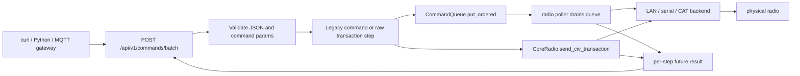

# Web Server API

Built-in HTTP + WebSocket interface used by the browser UI and automation clients.

## Stability Contract

The managed-supervisor contract is versioned separately from the browser UI.
The current contract version is `1`.

Stable routes are source-compatible within the same major `/api/v1` namespace:

- existing required response fields remain present;
- new optional fields may be added without a version bump;
- new enum/string values may be added when clients can ignore unknown values;
- removing fields, changing field type, or changing route semantics requires a
  new versioned route or an explicit migration note.

Stable contract metadata is maintained in `rigplane.web.api_contract` and
covered by tests. Pro and other supervisors should depend on the stable routes
below, not on browser static assets, private handler classes, or routes marked
diagnostic/experimental.

## Application authentication removal

Core HTTP and WebSocket clients that can reach the listener need no application
credential. Bearer headers and query tokens no longer authenticate requests.
This changes the previous token-protected route semantics without changing the
`/api/v1` route names. See `src/rigplane/web/web_routing.py: dispatch_http_request`
and `src/rigplane/web/server.py: WebServer._handle_websocket`.

Remove `--auth-token` and `--auth-token-file` from `web` and `station` launch
arguments: they now fail during argument parsing, before radio startup, without
reading a token file. `RIGPLANE_AUTH_TOKEN` is ignored. Programmatic callers must
omit `WebConfig.auth_token` or leave it empty; a nonempty value raises
`ValueError`. See `src/rigplane/cli/__init__.py: _reject_retired_auth_option`,
`_cmd_web`, and `src/rigplane/web/server.py: WebConfig.__post_init__`.

Radio login credentials, bind selection and TLS options retain their existing
roles. Diagnostic send/save/delete requests still use preview-bound
`X-Diagnostic-CSRF`; diagnostic submission still requires consent. The
diagnostic routes no longer carry their own Origin check: the
state-changing-request Origin rule below (MOR-2881) covers them, and the old
per-handler `check_origin_or_loopback` with its loopback skip is gone. See
`src/rigplane/web/web_routing.py: dispatch_http_request` and
`src/rigplane/web/handlers/diagnostics.py: DiagnosticsHandler`.

### Host allowlist, Origin guards (MOR-2880, MOR-2881)

Without an application credential, the listener itself is the boundary, so
every HTTP route and every WebSocket upgrade now runs a Host allowlist before
any handler. The RAW `Host` request header is checked — never a value derived
from the bind address or a server name. After lowercasing, stripping trailing
dots and the port (bracketed IPv6 such as `[::1]:8470` is handled; a port tail
must be 1-5 ASCII digits), the host part is admitted when it is:

- an IP literal, IPv4 or IPv6;
- a single-label name matching `[a-z0-9]([a-z0-9-]*[a-z0-9])?`;
- a name ending in `.localhost`, `.local`, `.home.arpa` or `.internal`,
  compared case-insensitively;
- a dotted name passed via the repeatable `--allowed-host NAME` flag on the
  `web` command (`WebConfig.allowed_hosts`); a single-label name is decided by
  the pattern above alone.

A MISSING `Host` header is admitted. Everything else — including empty or
malformed values — gets `421` with the JSON body
`{"error": "misdirected request: host not allowed"}`. A refused WebSocket
upgrade gets its `421` before the `101` handshake. See
`src/rigplane/web/host_guard.py: host_header_allowed`,
`src/rigplane/web/web_routing.py: dispatch_http_request` and
`src/rigplane/web/server.py: WebServer._handle_websocket`; refusals log one
throttled WARNING naming the path, Origin and Host
(`src/rigplane/web/server.py: WebServer._log_refused_request`). Pinned by
`tests/test_web_origin_host_guard.py: test_ws_foreign_or_malformed_host_refused_with_421`,
`test_ws_local_hosts_accepted`, `test_http_foreign_or_malformed_host_refused_with_421`,
`test_http_local_hosts_accepted` and `test_ws_allowed_host_flag_admits_configured_name`.

The four WebSocket upgrades (`/api/v1/ws`, `/api/v1/scope`,
`/api/v1/audio-scope`, `/api/v1/audio`) and every state-changing HTTP
request — `POST`, `PUT`, `PATCH` or `DELETE` on any path, plus `GET
/clearcache`, which wipes the browser's storage for this origin via its
`Clear-Site-Data` response — enforce the same same-origin `Origin` rule
with no loopback exception: a missing `Origin` is admitted (non-browser
clients; the Pro supervisor's proxy sends none on either leg), while a
present one must be same-origin with the request — scheme, host and
port — and its host must pass the Host allowlist, or the request is
refused with `403` and the JSON body
`{"error": "forbidden: origin not allowed"}` before any handler or
upgrade runs. Read-only `GET`/`HEAD` routes admit any `Origin`. The one
comparison lives in `src/rigplane/web/host_guard.py: origin_matches_host`
behind `src/rigplane/web/host_guard.py: same_origin_allowed`, applied by
`src/rigplane/web/web_routing.py: dispatch_http_request` (HTTP requests)
and `src/rigplane/web/server.py: WebServer._handle_websocket`
(upgrades). Pinned by `tests/test_web_origin_host_guard.py:
test_ws_foreign_origin_refused_before_upgrade`,
`test_ws_same_origin_accepted`, `test_ws_missing_origin_accepted`,
`test_http_state_changing_foreign_origin_refused`,
`test_http_state_changing_same_origin_admitted`,
`test_http_state_changing_missing_origin_admitted`,
`test_http_origin_checked_before_route_semantics`,
`test_http_clearcache_foreign_origin_refused`,
`test_http_clearcache_missing_origin_admitted` and
`test_http_read_only_get_foreign_origin_still_admitted`, plus
`tests/test_web_diagnostics.py: test_cross_origin_send_blocked`,
`test_loopback_bind_foreign_origin_refused` and
`test_loopback_bind_no_origin_admitted`.

The `authRequired` runtime and station fields remain Boolean and are now `false`
(`src/rigplane/web/server.py: WebServer._serve_runtime`,
`WebServer._station_readiness_payload`).

## HTTP Endpoints

### Stable Supervisor Endpoints

These routes are part of the Pro/supervisor compatibility surface:

| Method | Path | Purpose |
|-------|------|---------|
| `GET` | `/healthz` | Process/API liveness |
| `GET` | `/readyz` | Station readiness, returns `503` until radio is ready |
| `GET` | `/api/v1/runtime` | Process, bind, radio, rigctld, bridge, and diagnostic runtime status |
| `GET` | `/api/v1/station` | Friendly station-server identity, readiness, and next-action status |
| `GET` | `/api/v1/info` | Runtime model/capability summary |
| `GET` | `/api/v1/state` | Canonical current state snapshot |
| `GET` | `/api/v1/capabilities` | Full profile-backed capabilities |
| `GET` | `/api/v1/audio/analysis` | Audio analysis snapshot when analyzer is active |
| `GET` | `/api/v1/managed-transmit` | Managed transmit authority snapshot |
| `POST` | `/api/v1/managed-transmit/command` | Submit a latched transmit or force-off intent |
| `PUT` | `/api/v1/managed-transmit/tot` | Update the managed transmit time-out |
| `GET` | `/api/v1/bridge` | Audio bridge status |
| `POST` | `/api/v1/bridge` | Start audio bridge |
| `DELETE` | `/api/v1/bridge` | Stop audio bridge |
| `POST` | `/api/v1/commands` | Apply one structured radio command and answer with its outcome |
| `POST` | `/api/v1/commands/batch` | Apply a stateless ordered command batch |

### Other Web UI Endpoints

| Method | Path | Purpose |
|-------|------|---------|
| `GET` | `/api/v1/dx/spots` | Buffered DX spots |
| `GET` | `/api/v1/band-plan/config` | Active band-plan region |
| `GET` | `/api/v1/band-plan/layers` | Band-plan layers metadata |
| `GET` | `/api/v1/band-plan/segments?start=<hz>&end=<hz>&layers=<csv>` | Band-plan overlay segments |
| `GET` | `/api/v1/eibi/status` | EiBi loader status |
| `GET` | `/api/v1/eibi/stations` | EiBi station list (paged/filterable) |
| `GET` | `/api/v1/eibi/segments?start=<hz>&end=<hz>&on_air=true` | EiBi overlay segments |
| `GET` | `/api/v1/eibi/identify?freq=<hz>&tolerance=<hz>` | Identify probable broadcast stations |
| `GET` | `/api/v1/eibi/bands` | EiBi frequency bands |
| `POST` | `/api/v1/transport/webrtc/offer` | Gated WebRTC DataChannel SDP exchange |
| `POST` | `/api/v1/transport/webrtc/ice-candidate` | Gated WebRTC ICE trickle for a negotiated session |

### Control Endpoints

| Method | Path | Purpose |
|-------|------|---------|
| `POST` | `/api/v1/radio/connect` | Connect/reconnect radio control path |
| `POST` | `/api/v1/radio/disconnect` | Disconnect radio control path |
| `POST` | `/api/v1/radio/power` | Power on/off (body `{"state": "on"}` or `{"state": "off"}`) through the backend's `set_powerstat` |
| `POST` | `/api/v1/commands` | Apply one structured radio command and answer with its outcome |
| `POST` | `/api/v1/commands/batch` | Apply a stateless ordered command batch |
| `POST` | `/api/v1/civ/transaction` | Send one scoped raw CI-V transaction |
| `POST` | `/api/v1/band-plan/config` | Change active region and reload band plans (only when running from a source checkout: the wheel does not include `band-plans/`) |
| `POST` | `/api/v1/eibi/fetch` | Fetch/refresh EiBi dataset |

### WebSocket Routes

Stable supervisor routes:

| Path | Purpose | Availability |
|------|---------|--------------|
| `/api/v1/ws` | Control events and commands | always |
| `/api/v1/scope` | Hardware or audio FFT spectrum stream | when scope or audio FFT is available |
| `/api/v1/audio` | Audio control and media frames | when radio/audio backend supports audio |
| `/api/v1/audio-scope` | Audio FFT spectrum stream | when audio FFT is available |

### Keepalive

The `/api/v1/ws`, `/api/v1/scope`, and `/api/v1/audio-scope` routes answer a JSON `{"type":"ping"}` text frame with `{"type":"pong"}`: the control route in `src/rigplane/web/handlers/control.py: ControlHandler._handle_text`, and both scope routes in `src/rigplane/web/handlers/scope.py: ScopeHandler._handle_control` (`/api/v1/audio-scope` is served by `ScopeHandler` with `audio_mode=True`; see `src/rigplane/web/server.py: WebServer._handle_websocket`). `/api/v1/audio` does not answer ping frames: `src/rigplane/web/handlers/audio.py: AudioHandler._handle_control` handles only `audio_start`, `audio_stop`, `audio_config`, and `audio_stats`. The browser client sends that ping every 15 s on the channels that use `WsChannel` (`frontend/src/lib/transport/ws-client.ts: KEEPALIVE_INTERVAL_MS`) — the control channel and the named `scope` and `audio-scope` channels (`getChannel`, wired in `scope-controller.svelte.ts: ScopeController`) — and closes and reconnects a channel when no frame of any kind arrives for 30 s (`HEARTBEAT_TIMEOUT_MS`).

### Multi-client sessions and TX ownership

Every client may read state, scope and audio, and any client may command the radio. Between clients the server enforces one rule: one transmitter holder at a time. Whoever keys holds TX until it is released; keying from anyone else is refused. The server authenticates no client: a controller session key correlates one client's channels and is not a credential.

- `POST /api/v1/controller` with `{"kind": "browser"}` or `{"kind": "pro"}` opens a session (`201` with `controller_key`, `generation`, `ttl_ms` 6000 and `heartbeat_ms` 2000). Any number of sessions may exist.
- WebSocket channels join a session with the subprotocol `rigplane-controller-v1.<controller_key>`. The session's first `/api/v1/ws` channel is its primary (`controller_role=primary`, the default) and sends `{"type": "controller_heartbeat"}` every 2 s; further channels are auxiliaries (`controller_role=auxiliary` on `/api/v1/ws`; `/api/v1/audio`, `/api/v1/scope` and `/api/v1/audio-scope` always). An HTTP request acts for the session when it carries `X-RigPlane-Controller: <controller_key>`. An unknown or ended key is refused with `403 {"error": "controller_invalid"}`; `DELETE /api/v1/controller` with the header ends the session.
- The session owns the TX it keys: `ptt_on` from any of its control channels, and `transmit_on` on `POST /api/v1/managed-transmit/command` sent with its header. While one owner holds TX, `ptt_on` and `transmit_on` from any other owner are rejected (`transmit_on` answers `409`), and `send_cw_text`, `set_vox` with `on` not `false`, and `set_tuner_status` with `value` 2 and `set_break_in` with `mode` not 0 are refused with `controller_tx_unsupported`, and refused again if another owner keys before they run. `force_off` is accepted from anyone.
- While no owner holds or owes TX, a TX the radio's PTT readback reports is never keyed over. It is `radio_tx_unreleased` when no RX was observed since Core's own TX last ended (Core's own TX the radio did not release, or a poll taken before the release landed), and `radio_tx_unowned` after an RX, before Core's first TX, or when that history is no longer known (for example the operator's own microphone or PTT at the radio). Either way `ptt_on` and `transmit_on` from anyone are refused with that code (`transmit_on` answers `409`); so are `send_cw_text`, `set_vox` with `on` not `false`, `set_tuner_status` with `value` 2 and `set_break_in` with `mode` not 0, when received and again when they run. Over rigctld, `T 1` and `U VOX 1` answer `RPRT -9`. `force_off` is never refused: it unkeys whoever keyed, the operator's own TX included. `stop_cw_text` is not refused. Core's own CW text still being sent while no owner holds TX reads the same way, so further CW text is refused until the radio reports RX. Keying works again once the radio reports RX.
- A session ends when its primary channel closes or when its primary sends no heartbeat for 6 s (checked every 2 s, so TX on a silent link is released within about 8 s). An ended session's channels are closed and the TX it holds is released; other sessions are not affected. Closing an auxiliary `/api/v1/ws` channel releases the session's TX only when that channel's own last PTT request was a key (`ptt_on`, or `ptt` with `state` true).
- While a session holds TX, TX audio on the WebSocket route `/api/v1/audio` is admitted only from that session's own channel; frames from any other `/api/v1/audio` channel, sessionless ones included, are dropped (logged as `action=dropped_tx_gate_closed`). TX audio over the optional WebRTC `audio` DataChannel is not pinned to the holder.
- The per-client WebSocket limit (9 per channel path) counts a session's channels against that session and sessionless channels against their IP, so clients behind one gateway IP do not evict each other. Channels of the TX holder's session, and the control channel of a sessionless socket that keyed PTT, are never evicted.
- Clients without a session keep the earlier behaviour. Each sessionless control socket is its own TX owner, and the rule above applies to it. Their TX audio is not pinned to their own keying: while a sessionless socket holds TX, any sessionless audio channel may feed it. The bundled web frontend currently connects without a session in local mode. A sessionless `transmit_on` has no owner: a later sessionless `transmit_on` is accepted, a session's is rejected, and no disconnect releases it (`force_off` and the TOT do).

### rigctl channel (`/api/v1/rigctl`)

A remote CAT client (WSJT-X, a logger) can run the Hamlib rigctld protocol over a WebSocket that joins its session, so its keying and its TX audio belong to the same owner. The channel is served by the bundled rigctld server (`src/rigplane/rigctld/server.py: RigctldServer.open_channel`); only the transport is new (`src/rigplane/web/handlers/rigctl.py`).

- Attach with the session subprotocol `rigplane-controller-v1.<controller_key>` (an auxiliary channel: the session needs its primary). A request without a session is refused before the upgrade with `403 {"error": "controller_session_required"}`; so is any request in the exclusive remote mode. A sessionless rigctld client uses the TCP port instead.
- Each text message carries one or more rigctld command lines; a missing final newline is implied and a line never spans two messages. Each reply comes back as one text message, in command order. A binary message closes the channel (`1003`).
- Commands run through the same parser, handler and managed-PTT path as a TCP client, with the session as owner: `T 1` keys as the session, the session's `/api/v1/audio` channel then feeds that TX, and another owner's `T 1` is refused with `RPRT -9` while the session holds. Closing the channel releases the TX the session holds only when the channel's own last `T` keyed (any value but `0`); the session ending releases it either way.
- Limits are rigctld's: the channel counts against `max_clients` (10 by default, shared with TCP clients), lines over 1024 bytes and 300 s of silence close it, and a configured command rate limit applies. One rigctl channel per session; a second is closed with `1013`, as is one over `max_clients`. The per-session WebSocket cap above also applies.
- Available only when the bundled rigctld runs with managed TX (`web` and `station`); otherwise the channel closes with `1008`.

### Optional WebRTC DataChannels

WebRTC is optional and requires the `rigplane[webrtc]` extra (`aiortc`). There
are two gated HTTP signaling routes for the DataChannel transport:

| Method | Path | Status | Gate | Notes |
|-------|------|--------|------|-------|
| `POST` | `/api/v1/transport/webrtc/offer` | experimental transport entrypoint | `WebConfig.webrtc_enabled` / CLI `--webrtc` plus `rigplane[webrtc]` | Stateless client-facing SDP exchange that keeps a live session and returns `{ "status": "ok", "sessionId": "...", "sdp": "...", "type": "answer" }`. |
| `POST` | `/api/v1/transport/webrtc/ice-candidate` | experimental transport entrypoint | `WebConfig.webrtc_enabled` / CLI `--webrtc` plus `rigplane[webrtc]` | Adds a browser `RTCIceCandidateInit` for an existing `sessionId`; `candidate: null` marks end-of-candidates. |

The gated transport path is a transport alternative for the same handlers and
wire frames used by WebSockets:

| DataChannel | Reliability | Handler contract |
|-------------|-------------|------------------|
| `control` | ordered, reliable | Same JSON control frames as `/api/v1/ws` |
| `scope` | unordered, `maxRetransmits=0` | Same binary scope frames as `/api/v1/scope` |
| `audio` | unordered, `maxRetransmits=0` | Same JSON/binary audio frames as `/api/v1/audio` |

The gated transport routes are default-off. If `WebConfig.webrtc_enabled` is
false, or `aiortc` is missing, they return HTTP `503` with
`code: "webrtc_unavailable"`. The CLI enables the gate with `rigplane --model <MODEL>
web --webrtc`; programmatic callers set `WebConfig(webrtc_enabled=True)`.

`/api/v1/info` exposes `capabilities.hasWebrtc` (aiortc importable and the
radio has audio); it does not show whether the routes are enabled.
`/api/v1/capabilities` includes a `webrtc` block whose `available` (aiortc
importable) and `enabled` (`WebConfig.webrtc_enabled`) fields are the two
conditions the `/api/v1/transport/webrtc/*` routes check.

### Structured Command Surface

`/api/v1/ws`, `POST /api/v1/commands`, and
`POST /api/v1/commands/batch` use the same structured command names and
`params` objects. For example, `set_freq` and `set_mode` mean the same thing
over WebSocket, single-command HTTP, and batch HTTP.

The current public docs include common command examples in
[Web UI: Common commands](../guide/web-ui.md#common-commands), and lower-level
Python/CI-V command examples in [CI-V Commands](../guide/commands.md). The full
machine-readable HTTP/WS command catalog — every command name, parameter shape,
capability gate, and batch-eligibility flag — is published in
[HTTP / WebSocket Command Catalog](command-catalog.md).

The catalog documents the current command surface. A route or command is not a
stable API contract solely because it appears there; stability still comes from
explicit promotion into `rigplane.web.api_contract`.

### Internal And Diagnostic Surface

Browser static files, `src/rigplane/web/static*`, handler class names, queue
shapes, diagnostic upload routes, EiBi/Band Plan helpers, and DX cluster helper
routes are not the Pro supervisor contract unless they are promoted into
`rigplane.web.api_contract`.

---

## `GET /healthz`

Process liveness probe for local supervisors.

```json
{
  "status": "ok",
  "pid": 12345,
  "version": "3.0.0b9"
}
```

## `GET /readyz`

Station readiness probe. Returns HTTP `200` when the attached radio is ready
and HTTP `503` while the process is alive but the station is not ready.

```json
{
  "status": "ready",
  "radioReady": true
}
```

While the first LAN connect waits out a busy session reject, the probe
returns HTTP `503` with a `session_busy` reason and the hold's retry
number in `retryInSeconds` — the live cooldown remainder while a
re-login waits, else the hold's cooldown between attempts (pinned by
`test_web_serves_session_busy_during_startup_busy_hold`,
`test_not_ready_between_busy_passes_keeps_the_hold_retry_number` and
`test_busy_retry_number_inside_cooldown_is_the_live_remainder`):

```json
{
  "status": "not_ready",
  "radioReady": false,
  "reason": "session_busy",
  "retryInSeconds": 30.0
}
```

## `GET /api/v1/runtime`

Machine-readable runtime status for managed local supervisors and diagnostics.

```json
{
  "pid": 12345,
  "uptimeSeconds": 12.3,
  "version": "3.0.0b9",
  "bind": { "host": "127.0.0.1", "port": 8080 },
  "logPath": "/Users/me/Library/Caches/rigplane/logs/rigplane.log",
  "authRequired": false,
  "backend": "rigplane",
  "radio": {
    "model": "IC-7610",
    "connected": true,
    "controlConnected": true,
    "radioReady": true
  },
  "station": {
    "readiness": "ready_with_radio",
    "radioAvailable": true,
    "backend": "rigplane",
    "authRequired": false,
    "message": "Station server is ready with an attached radio."
  },
  "rigctld": {
    "enabled": true,
    "address": "127.0.0.1:4532"
  },
  "bridge": {
    "enabled": false,
    "running": false
  },
  "process": {
    "rssBytes": 187654144,
    "openFds": 41,
    "threads": 6,
    "asyncioTasks": 23,
    "reconnectsTotal": 0
  },
  "lastError": null
}
```

`process` carries process metrics, read when the request is served
(`server.py: WebServer._runtime_process_payload`). A value the platform cannot
report is `null`.

| Field | Source |
|---|---|
| `rssBytes` | Current resident set size in bytes: from `/proc/self/statm` on Linux, from `proc_pidinfo` (`PROC_PIDTASKINFO`, `pti_resident_size`) on macOS; `null` where neither is available (for example Windows). |
| `openFds` | Open file descriptors listed in `/proc/self/fd` or `/dev/fd`; `null` where neither can be listed (Windows). |
| `threads` | Python threads, `threading.active_count()`. |
| `asyncioTasks` | Unfinished tasks on the server's event loop, `asyncio.all_tasks()`. |
| `reconnectsTotal` | Link-loss episodes since the relevant component was created. LAN radios count `reconnecting` edges reported to `WebServer._on_reconnect_status`. Serial CI-V radios count CONNECTED-to-RECONNECTING edges in `_IcomSerialRadioBase._count_serial_link_episode` (called from `_declare_serial_link_down` and `soft_reconnect`). Yaesu CAT radios count the first reconnect after the last successful exchange in `TransportStats.record_reconnect_attempt` (exposed as `YaesuCatRadio.serial_reconnects_total`). `null` when the radio has neither source — no started LAN watchdog and no serial episode counter. |

## `POST /api/v1/commands`

HTTP command envelope for automation clients that do not need WebSocket
delivery. The command names and `params` match the `/api/v1/ws` command channel.
The endpoint answers only after the command executes, returning the
command's `result` object in an `{ok, name, result}` envelope (plus `id`
when the request has one) — the same body `ControlHandler._enqueue_command`
returns for that request. When the poller reports the write refused, the
endpoint answers HTTP `409` with `error: "radio_nak"`; a command the poller
never settles answers HTTP `504` with `error: "command_timeout"`. Writes the
backend sends without waiting for a reply (such as the `CoreRadio` AF/RF
level, mode and power writes in `runtime/radio.py`) still answer `200` when
the radio NAKs them, because the NAK is never observed.

Request:

```json
{
  "id": "button-1",
  "name": "set_freq",
  "params": { "freq": 144030000, "receiver": 0 }
}
```

Response:

```json
{
  "id": "button-1",
  "ok": true,
  "name": "set_freq",
  "result": { "freq": 144030000, "receiver": 0 }
}
```

`id` is optional and echoed when present. Unknown command names and malformed
parameters return HTTP `400`. Read-only mode rejects transmit commands with
HTTP `403`.

Low-level CI-V escape hatch:

```json
{
  "id": "display-type-b",
  "name": "send_civ",
  "params": {
    "command": 26,
    "sub": 5,
    "data": "015301"
  }
}
```

`send_civ` is for Icom/vendor-specific commands that are not yet exposed as
structured RigPlane commands. `command` and `sub` are byte values from `0` to
`255`; `sub` may be omitted. `data` is an even-length hexadecimal string. The
HTTP command waits for the poller to execute the CI-V write through the
same single-owner command queue, but does not return CI-V response bytes or
claim readback verification. `wait_response` is rejected when `true`; use
`POST /api/v1/civ/transaction` when the caller needs an ACK, NAK, or data
response.

## `POST /api/v1/civ/transaction`

Scoped raw CI-V transaction endpoint for local automation that needs a
deterministic radio response. This endpoint bypasses the normal
`RadioPoller` command queue, claims the CI-V stream while the transaction is
active, and releases that claim on success, NAK, timeout, error, or
cancellation. It uses the existing runtime CI-V receive pump and request
tracker; it does not create a second raw listener path.

Request:

```json
{
  "id": "display-type-b",
  "command": 26,
  "sub": 5,
  "data": "015301",
  "expect": "ack",
  "timeout_ms": 1000
}
```

`command` and `sub` are byte values from `0` to `255`; `sub` may be omitted.
`data` is an even-length compact hexadecimal string. `expect` is optional on this
endpoint and defaults to `"data"`; when present it must be one of:

| Value | Behavior |
|-------|----------|
| `"none"` | Send the raw CI-V frame and return `status: "sent"` without waiting |
| `"ack"` | Wait for the next CI-V ACK or NAK and return `status: "ack"` or `"nak"` |
| `"data"` | Wait for the matching data response for the request command/sub |

`timeout_ms` is optional and must be positive when present. All waits are
bounded by the timeout.

Python example:

```python
import json
import urllib.request

base_url = "http://127.0.0.1:8080"

payload = {
    "id": "display-type-b",
    "command": 26,
    "sub": 5,
    "data": "015301",
    "expect": "ack",
    "timeout_ms": 1000,
}

request = urllib.request.Request(
    f"{base_url}/api/v1/civ/transaction",
    data=json.dumps(payload).encode("utf-8"),
    headers={"Content-Type": "application/json"},
    method="POST",
)

with urllib.request.urlopen(request, timeout=5) as response:
    result = json.load(response)

if not result["ok"]:
    raise SystemExit(result)
```

ACK response:

```json
{
  "id": "display-type-b",
  "ok": true,
  "status": "ack",
  "result": {
    "frame": "FEFEE0A2FBFD",
    "command": 251,
    "sub": null,
    "data": ""
  }
}
```

NAK response uses HTTP `200` with deterministic failure JSON:

```json
{
  "ok": false,
  "status": "nak",
  "error": "radio_nak",
  "result": {
    "frame": "FEFEE0A2FAFD",
    "command": 250,
    "sub": null,
    "data": ""
  }
}
```

Errors:

| HTTP | Error | Meaning |
|------|-------|---------|
| `400` | `invalid_request` | Malformed command/sub/data/expect/timeout |
| `403` | `read_only` | Server is running in read-only mode |
| `409` | `unsupported_command` | Active backend does not expose raw CI-V transactions |
| `409` | `civ_owner_conflict` | Another external CAT/transaction owner already owns the CI-V stream |
| `503` | `no_radio` | No radio backend is configured |
| `504` | `transaction_timeout` | Expected ACK/data response did not arrive before timeout |

Use this endpoint only for model-specific commands where callers need the
wire-level result. Keep normal profile/control automation on
`/api/v1/commands` or `/api/v1/commands/batch`.

## `POST /api/v1/commands/batch`

Stateless ordered batch apply for local automation. RigPlane does not store,
name, schedule, or share batches in Core. Clients send the full sequence on
each request.

Use this endpoint when an external controller needs one ordered profile
switch: tune frequency, select mode/filter, adjust levels, switch
audio/data state, recall memory, query model-specific CI-V state, or apply
other supported operations as one ordered operation.

Batch steps are validated and executed in request order. Legacy command steps
are placed on an exact-order command-queue lane, and the HTTP handler waits for
the poller/backend to finish that step before advancing to the next step.
Raw CI-V transaction steps execute through `send_civ_transaction()` outside
`RadioPoller`; the handler still waits for each transaction result before
considering the next request step. Repeated commands are not deduplicated
inside the ordered lane.

Maximum batch size is 128 steps. Legacy command steps use a 10 second
execution timeout. Raw CI-V transaction steps use `timeout_ms` when present,
otherwise the same 10 second default. If the radio link is slow or
disconnected, the failing step is reported and later steps are skipped unless
`continue_on_error` is `true`.

Batch steps can use either shape:

- legacy command steps: `{ "name": "set_freq", "params": { ... } }`;
- response-capable raw CI-V transaction steps:
  `{ "type": "raw_civ_transaction", ... }`.

`send_civ` remains the fire-and-forget raw CI-V command. It is queued like
other legacy command steps, returns the command parameters that were accepted,
does not wait for ACK/data/NAK frames, and still rejects `wait_response=true`.
Use a `raw_civ_transaction` step when the caller needs the radio's wire-level
ACK, NAK, or data response inside the ordered batch.

Data flow:



Request:

```json
{
  "id": "vara-fm",
  "continue_on_error": false,
  "steps": [
    { "name": "set_freq", "params": { "freq": 144030000 } },
    {
      "name": "send_civ",
      "params": { "command": 26, "sub": 5, "data": "015301" }
    },
    {
      "type": "raw_civ_transaction",
      "id": "display-type-query",
      "command": 26,
      "sub": 5,
      "data": "0153",
      "expect": "data",
      "timeout_ms": 250
    },
    {
      "type": "raw_civ_transaction",
      "id": "display-type-apply",
      "command": 26,
      "sub": 5,
      "data": "015301",
      "expect": "ack"
    },
    {
      "name": "set_mode",
      "params": { "mode": "FM" }
    }
  ]
}
```

Raw CI-V transaction step fields:

| Field | Required | Meaning |
|-------|----------|---------|
| `type` | yes | Must be `"raw_civ_transaction"` |
| `command` | yes | CI-V command byte, `0` through `255` |
| `expect` | yes | `"none"`, `"ack"`, or `"data"` |
| `id` | no | Caller-owned value echoed in this step's result |
| `sub` | no | CI-V subcommand byte, `0` through `255` |
| `data` | no | Compact even-length hexadecimal string; response hex is uppercase |
| `timeout_ms` | no | Positive finite timeout in milliseconds for this transaction step |

Successful response:

```json
{
  "id": "vara-fm",
  "ok": true,
  "results": [
    {
      "index": 0,
      "name": "set_freq",
      "ok": true,
      "status": "executed",
      "result": { "freq": 144030000, "receiver": 0 }
    },
    {
      "index": 1,
      "name": "send_civ",
      "ok": true,
      "status": "executed",
      "result": {
        "command": 26,
        "sub": 5,
        "data": "015301",
        "wait_response": false
      }
    },
    {
      "index": 2,
      "type": "raw_civ_transaction",
      "id": "display-type-query",
      "ok": true,
      "status": "response",
      "result": {
        "frame": "FEFEE0A21A05015301FD",
        "command": 26,
        "sub": 5,
        "data": "015301"
      }
    },
    {
      "index": 3,
      "type": "raw_civ_transaction",
      "id": "display-type-apply",
      "ok": true,
      "status": "ack",
      "result": {
        "frame": "FEFEE0A2FBFD",
        "command": 251,
        "sub": null,
        "data": ""
      }
    },
    {
      "index": 4,
      "name": "set_mode",
      "ok": true,
      "status": "executed",
      "result": { "mode": "FM", "receiver": 0 }
    }
  ]
}
```

`expect: "none"` sends one CI-V frame and returns `status: "sent"` without
waiting for a radio frame. `expect: "ack"` waits for ACK or NAK.
`expect: "data"` waits for the matching data response, while a fresh NAK still
returns `status: "nak"` and `error: "radio_nak"`.

NAK failure with skipped later steps:

```json
{
  "ok": false,
  "results": [
    {
      "index": 0,
      "type": "raw_civ_transaction",
      "ok": false,
      "status": "nak",
      "error": "radio_nak",
      "message": "radio returned CI-V NAK",
      "result": {
        "frame": "FEFEE0A2FAFD",
        "command": 250,
        "sub": null,
        "data": ""
      }
    },
    {
      "index": 1,
      "name": "set_mode",
      "ok": false,
      "status": "skipped",
      "error": "skipped_after_failure",
      "message": "skipped after earlier batch failure"
    }
  ]
}
```

Set `continue_on_error` to `true` to keep applying later valid steps after a
validation, timeout, or execution failure. When present, `continue_on_error`
must be a JSON boolean at the batch root. A transaction step-level
`continue_on_error` field is invalid. Raw CI-V transaction failures that obey
the continuation rule include `nak`, `timed_out`, `owner_conflict`,
`unsupported`, `read_only`, `no_radio`, `failed_validation`, and
`failed_execution`. Commands marked `Batch: No` in the command catalog, such
as `send_cw_text`, read-only getter commands, and direct helper operations, are
rejected in batches with `unsupported_in_batch`; use
`POST /api/v1/commands` for those one-off calls.

Timeout with `continue_on_error: true`:

```json
{
  "ok": false,
  "results": [
    {
      "index": 0,
      "type": "raw_civ_transaction",
      "ok": false,
      "status": "timed_out",
      "error": "transaction_timeout",
      "message": "raw CI-V transaction timed out"
    },
    {
      "index": 1,
      "name": "set_mode",
      "ok": true,
      "status": "executed",
      "result": { "mode": "FM", "receiver": 0 }
    }
  ]
}
```

Other raw CI-V transaction step failures use these per-step `status` and
`error` values:

| Case | `status` | `error` |
|------|----------|---------|
| Timeout | `timed_out` | `transaction_timeout` |
| Another CAT/transaction owner is active | `owner_conflict` | `civ_owner_conflict` |
| Backend lacks raw transaction support | `unsupported` | `unsupported_command` |
| Server is read-only | `read_only` | `read_only` |
| No active radio for a transaction-only batch | `no_radio` | `no_radio` |
| Malformed transaction step | `failed_validation` | `invalid_request` or `invalid_step` |
| Runtime failure from `send_civ_transaction()` | `failed_execution` | `transaction_failed` |
| Later step skipped after failure | `skipped` | `skipped_after_failure` |

Unsupported typed batch steps are handled separately from malformed
`raw_civ_transaction` steps. If a step has `type` present, the type is not
supported, and no legacy `name` is present, that step returns
`status: "failed_validation"` with `error: "unknown_step_type"`.

If a queued step is not consumed by the poller before the step timeout, the
result status is `timed_out` with error `command_timeout`. Unconsumed timed-out
steps are cancelled before execution. If a batch mixes legacy command steps
with raw transaction steps and no radio is configured, the endpoint keeps the
legacy behavior and returns HTTP `503 no_radio` before per-step execution.

### Profile-Switching Example

Core treats a radio profile as a caller-owned batch, not as stored server
state. Core does not store, name, schedule, or share profiles; callers own any
batch/profile catalog they build. This keeps the open-core API generic while
still supporting local Stream Deck, MQTT, shell, and Python automation.

Example IC-9700-style local batches:

```json
{
  "vara-fm": {
    "id": "vara-fm",
    "steps": [
      { "name": "set_freq", "params": { "freq": 144030000, "receiver": 0 } },
      { "name": "set_mode", "params": { "mode": "FM", "receiver": 0 } },
      { "name": "set_data_mode", "params": { "mode": 1, "receiver": 0 } },
      { "name": "set_data1_mod_input", "params": { "source": 3 } },
      { "name": "set_usb_mod_level", "params": { "level": 72 } },
      { "name": "set_af_level", "params": { "level": 72, "receiver": 0 } },
      { "name": "set_squelch", "params": { "level": 0, "receiver": 0 } }
    ]
  },
  "fm-voice": {
    "id": "fm-voice",
    "steps": [
      { "name": "set_mode", "params": { "mode": "FM", "receiver": 0 } },
      { "name": "set_data_mode", "params": { "mode": 0, "receiver": 0 } },
      { "name": "set_data_off_mod_input", "params": { "source": 0 } },
      { "name": "set_af_level", "params": { "level": 50, "receiver": 0 } }
    ]
  }
}
```

For `set_data_mode`, HTTP/WS params use the numeric DATA mode value from the
active radio profile, not an `enabled` boolean. The current IC-9700 profile
defines `0 = OFF`, `1 = DATA`. Its modulation input source values are
`0 = MIC`, `1 = ACC`, `2 = MIC+ACC`, `3 = USB`, and `4 = MIC+USB`.

Actual command availability depends on the active radio profile and backend.
Fetch `/api/v1/capabilities` before enabling buttons or publishing a reusable
profile.

### Automation Examples

Check capabilities before building model-specific batches. The capability
payload tells clients which receivers, modes, filters, audio controls, and
feature toggles are available on the active radio:

```bash
curl http://127.0.0.1:8080/api/v1/capabilities
```

Prefer structured commands whenever a command exists. Use `send_civ` for
vendor-specific CI-V that is not yet abstracted, such as display/menu settings.
It still lets RigPlane own the radio connection, queueing, pacing,
and safety checks; it just does not return response bytes.

Python example:

```python
import json
import urllib.request

base_url = "http://127.0.0.1:8080"

batch = {
    "id": "vara-fm",
    "steps": [
        {"name": "set_freq", "params": {"freq": 144030000}},
        {"name": "set_mode", "params": {"mode": "FM"}},
        {"name": "set_data_mode", "params": {"mode": 1}},
        {"name": "set_data1_mod_input", "params": {"source": 3}},
        {"name": "set_usb_mod_level", "params": {"level": 72}},
        {"name": "set_af_level", "params": {"level": 72}},
    ],
}

body = json.dumps(batch).encode("utf-8")
request = urllib.request.Request(
    f"{base_url}/api/v1/commands/batch",
    data=body,
    headers={"Content-Type": "application/json"},
    method="POST",
)

with urllib.request.urlopen(request, timeout=30) as response:
    result = json.load(response)

if not result["ok"]:
    raise SystemExit(result)
```

Minimal MQTT gateway sketch:

```python
import json
import urllib.request

import paho.mqtt.client as mqtt

RIGPLANE_URL = "http://127.0.0.1:8080"

BATCHES = {
    "vara-fm": {
        "id": "vara-fm",
        "steps": [
            {"name": "set_freq", "params": {"freq": 144030000}},
            {"name": "set_mode", "params": {"mode": "FM"}},
            {"name": "set_data_mode", "params": {"mode": 1}},
            {"name": "set_data1_mod_input", "params": {"source": 3}},
            {"name": "set_usb_mod_level", "params": {"level": 72}},
        ],
    },
    "fm-voice": {
        "id": "fm-voice",
        "steps": [
            {"name": "set_mode", "params": {"mode": "FM"}},
            {"name": "set_data_mode", "params": {"mode": 0}},
            {"name": "set_data_off_mod_input", "params": {"source": 0}},
            {"name": "set_af_level", "params": {"level": 50}},
        ],
    },
}


def post_batch(batch: dict) -> None:
    body = json.dumps(batch).encode("utf-8")
    request = urllib.request.Request(
        f"{RIGPLANE_URL}/api/v1/commands/batch",
        data=body,
        headers={"Content-Type": "application/json"},
        method="POST",
    )
    with urllib.request.urlopen(request, timeout=30) as response:
        result = json.load(response)
    if not result["ok"]:
        print("RigPlane batch failed:", result)


def on_message(client, userdata, message) -> None:
    profile_name = message.payload.decode("utf-8").strip()
    batch = BATCHES.get(profile_name)
    if batch is not None:
        post_batch(batch)


client = mqtt.Client()
client.on_message = on_message
client.connect("127.0.0.1", 1883)
client.subscribe("radio/profile")
client.loop_forever()
```

## `GET /api/v1/station`

Friendly station-server status for desktop supervisors and setup tools.

```json
{
  "schema": "rigplane.station.status.v1",
  "service": "rigplane",
  "kind": "station_server",
  "version": "3.0.0b9",
  "displayName": "IC-7610",
  "instanceId": null,
  "baseUrl": "http://127.0.0.1:58421",
  "healthUrl": "http://127.0.0.1:58421/healthz",
  "readinessUrl": "http://127.0.0.1:58421/readyz",
  "runtimeUrl": "http://127.0.0.1:58421/api/v1/runtime",
  "stationUrl": "http://127.0.0.1:58421/api/v1/station",
  "station": {
    "readiness": "ready_with_radio",
    "radioAvailable": true,
    "backend": "rigplane",
    "authRequired": false,
    "message": "Station server is ready with an attached radio."
  },
  "radio": {
    "model": "IC-7610",
    "connected": true,
    "controlConnected": true,
    "radioReady": true
  }
}
```

Current readiness values are:

- `ready_with_radio`
- `radio_powered_off_or_unreachable`
- `no_usb_radio_connected`
- `lan_radio_unsupported_or_not_found`
- `requires_configuration_or_auth`
- `radio_session_busy`
- `operator_disconnected`

`requires_configuration_or_auth` retains its compatibility spelling and refers
to radio target configuration, not an application credential prompt
(`src/rigplane/web/server.py: WebServer._station_readiness_payload`).

UDP discovery responses use the same `rigplane.station.discovery.v1` schema.
Single-station responses keep the same top-level `kind: "station_server"`,
`url`, `urls`, `station`, and `radio` fields. Fleet-aware supervisors can add
an additive `radios` array and set `kind: "station_fleet"` while preserving the
legacy top-level single-radio fields for older clients:

```json
{
  "schema": "rigplane.station.discovery.v1",
  "kind": "station_fleet",
  "url": "http://192.168.1.50:58421",
  "urls": {
    "base": "http://192.168.1.50:58421",
    "station": "http://192.168.1.50:58421/api/v1/station"
  },
  "station": {
    "readiness": "ready_with_radio",
    "radioAvailable": true,
    "backend": null,
    "authRequired": false,
    "message": null
  },
  "radio": {
    "model": "IC-705",
    "connected": true,
    "controlConnected": false,
    "radioReady": true
  },
  "radios": [
    {
      "id": "portable",
      "model": "IC-705",
      "url": "http://192.168.1.50:58421",
      "status": "connected",
      "connected": true
    },
    {
      "id": "base",
      "model": "IC-7610",
      "url": "http://192.168.1.50:58422",
      "status": "available",
      "connected": false
    }
  ]
}
```

Clients that only understand the single-station response should ignore
unknown fields and continue using the top-level `url`/`radio` values. Fleet
clients should prefer `radios[]` when present.

Managed runtimes also emit a single machine-readable startup event to stdout
after the web listener has bound successfully. Supervisors should use this JSON
line as the startup contract instead of parsing the human-readable banner:

```json
{
  "type": "rigplane.runtime.started",
  "pid": 12345,
  "baseUrl": "http://127.0.0.1:58421",
  "healthUrl": "http://127.0.0.1:58421/healthz",
  "runtimeUrl": "http://127.0.0.1:58421/api/v1/runtime",
  "logPath": "/Users/me/Library/Caches/rigplane/logs/rigplane-managed.log"
}
```

---

## `GET /api/v1/info`

Version, model, capability summary, and connection metadata.

```json
{
  "server": "rigplane",
  "version": "3.0.0b9",
  "proto": 1,
  "radio": "IC-7300",
  "model": "IC-7300",
  "capabilities": {
    "hasSpectrum": true,
    "hasAudio": true,
    "hasTx": true,
    "hasDualReceiver": false,
    "hasTuner": true,
    "hasCw": true,
    "cwText": { "supported": true, "maxLength": 512, "memoryChannel": null },
    "maxReceivers": 1,
    "modes": ["USB", "LSB", "CW", "CW-R", "AM", "FM", "RTTY", "RTTY-R"],
    "filters": ["FIL1", "FIL2", "FIL3"],
    "vfoScheme": "ab",
    "hasLan": false,
    "hasWebrtc": false
  },
  "connection": {
    "rigConnected": true,
    "radioReady": true,
    "controlConnected": true,
    "session": { "busy": false, "retryInSeconds": null },
    "wsClients": 2
  }
}
```

`connection.session` is always present: it reports a start-up busy hold
(`busy` with the hold's retry number in `retryInSeconds` — the live
cooldown remainder while a re-login waits, else the hold's cooldown
between attempts) and reads `{"busy": false, "retryInSeconds": null}`
otherwise (pinned by
`test_web_serves_session_busy_during_startup_busy_hold` and
`test_granted_busy_hold_becomes_ready_and_marks_transport_once`).

## `GET /api/v1/state`

Canonical full state payload for web consumers (camelCase keys).

- Includes `revision`, `healthRevision`, and `updatedAt`.
- Includes `connection` object (`rigConnected`, `radioReady`, `controlConnected`).
- Includes `radioHealth`, a classified server/radio health contract.
- For single-receiver profiles, `sub` key is omitted.
- Supports `ETag` based on `revision` and `healthRevision` for conditional
  requests, so radio-health-only changes are not hidden behind `304 Not Modified`.
- State keys are always present. A field whose observation has not arrived —
  unsupported by the radio, or simply not read yet — publishes `null`, never a
  fabricated default; `txTarget` excepted: it encodes absence fail-closed
  in-band (an unknown-status object), not as a dataclass default. `fieldStatus`
  keeps the reason (`missing`, `undeclared` or `unavailable`) per public leaf
  path (for example `main.freqHz`). Once a value has been observed it stays
  published, even when it later goes stale
  (`runtime_helpers.py: _null_unobserved_public_leaves`).

```json
{
  "main": { "freqHz": 14074000, "mode": "USB", "filter": 1 },
  "revision": 42,
  "healthRevision": 7,
  "updatedAt": "2026-03-15T10:00:00+00:00",
  "radioDetail": { "status": "connected" },
  "radioHealth": {
    "serverReachable": true,
    "radioLink": "connected",
    "readiness": "ready",
    "likelyCause": "unknown",
    "sinceMs": 0,
    "lastError": null
  },
  "wsClients": { "scope": 1, "control": 1, "audio": 0 },
  "connection": {
    "rigConnected": true,
    "radioReady": true,
    "controlConnected": true
  }
}
```

`radioHealth.likelyCause` distinguishes these public states:

| Value | Meaning |
|---|---|
| `server_unreachable` | Browser/client cannot reach the web or proxy server. The server normally cannot emit this for itself; clients derive it from HTTP/WS failures. |
| `radio_network_lost` | Server is reachable, but the radio link is disconnected or reconnecting. |
| `radio_remote_control_unreachable` | Server is reachable and the radio host answers, but its remote-control server is not listening; the link is disconnected or reconnecting. |
| `radio_not_responding` | Radio link still exists, but CI-V/control data is delayed or stalled. |
| `radio_powered_off_likely` | Server is reachable and either the radio was previously available and repeated timeout/recovery evidence suggests it is off or unreachable, or the server started against a radio that has not answered at all. |
| `radio_not_connected` | Server is reachable. It started while the radio's serial port could not be opened, the latest attempt to open the port failed, and the radio has not answered since. |
| `radio_session_busy` | The radio's LAN session is held by another client during a start-up busy hold; the first connect keeps retrying. |
| `operator_disconnected` | The operator disconnected the radio on purpose; health readiness is `idle`, which appears only with this cause (`src/rigplane/web/runtime_helpers.py: classify_radio_health`). |
| `unknown` | Insufficient evidence or healthy/ready state. |

## `GET /api/v1/capabilities`

Profile-backed capabilities used to build dynamic UI.

Notable fields:

| Field | Type | Notes |
|------|------|-------|
| `receivers` | `int` | Receiver count from active profile |
| `modeFamilies` | `object` | Profile `[modes] families`: family name -> mode names, e.g. `{"cw": ["CW-U", "CW-L"]}`. `{}` when the profile declares none. Also in `/api/v1/info` `capabilities`. Use it instead of guessing a radio's CW mode names. |
| `vfoScheme` | `"ab"` \| `"main_sub"` \| `"ab_shared"` \| `"single"` | VFO label scheme |
| `freqRanges[].bands[].bsrCode` | `int` (optional) | Band Stack Register code for `set_band` |
| `scopeSource` | `"hardware"` \| `"audio_fft"` \| `null` | Spectrum data source |
| `scopeConfig.defaultSpan` | `int` | Audio FFT bandwidth in Hz (48000 if unset) when the audio FFT scope exists, otherwise the constant 500000 |
| `audioConfig` | object | Web audio transport defaults |
| `webrtc.available` | `bool` | Whether the optional `rigplane[webrtc]` backend is importable; this does not indicate that the default-off `WebConfig.webrtc_enabled` transport gate is enabled |

| `cwText` | object | Whether `send_cw_text` works on this radio; see below. Required whenever a profile is resolved |

### `cwText`

`cwText` (MOR-3678) says whether typed CW text can be sent, from the
profile's `[cw_text]` section. It is inside `capabilities` on
`/api/v1/info` (next to `hasCw`) and a top-level key on
`/api/v1/capabilities`; both carry the same three fields. It is absent only
when no profile is resolved (a provider-owned backend).

| Field | Type | Notes |
|------|------|-------|
| `supported` | `bool` | `false`: `send_cw_text` is refused |
| `maxLength` | `int` | Longest text one request may carry; longer text is refused, never truncated or split |
| `memoryChannel` | `int` \| `null` | Keyer memory channel the text is written to and played from (FTX-1: KM then KY); `null` when the radio sends text directly (Icom) |

`cwText` is separate from the `cw` tag and `hasCw`, which keep driving the
CW decoder, console and keyer controls: the FTX-1 publishes `hasCw: true`
and `cwText.supported: false`. The server enforces both facts in one place
(the radio's `send_cw_text`), so `POST /api/v1/radio/cw/send`, the
WebSocket `send_cw_text` command and the CLI `cw` command refuse the same
requests with the same message:

| Refusal | Message | HTTP | WebSocket | CLI |
|------|------|------|------|------|
| Text too long | `CW text too long for <model>: got <n> characters, limit is <maxLength>` | `400` `invalid_request` | `command_failed` | `Error: <message>`, exit 1 |
| Not supported | `<model> does not support sending CW text yet` | `409` `unsupported_command` | `unsupported_command` | `Error: <message>`, exit 1 |

Clients only display these values.

When radio has audio but no hardware scope support, backend enables `AudioFftScope`
and reports `scopeSource: "audio_fft"`. The same FFT frames are also available
on `/api/v1/audio-scope`; hardware-scope radios keep `/api/v1/scope` sourced
from the radio's hardware scope.

---

## WebSocket And DataChannel Endpoints

| Path | Direction | Payload |
|------|-----------|---------|
| `/api/v1/ws` | bi-directional | JSON commands/events/state updates |
| `/api/v1/scope` | server -> client | Binary scope frames |
| `/api/v1/audio` | bi-directional | JSON control + binary audio frames |

The optional gated WebRTC transport uses `control`, `scope`, and `audio`
DataChannels that carry the same payloads as these WebSocket routes. WebRTC
changes only the transport, not command names, event names, binary headers, or
audio frame semantics.

Binary audio frames use an 8-byte header followed by codec-specific payload:

| Offset | Size | Field | Notes |
|--------|------|-------|-------|
| `0` | 1 | `msg_type` | `0x10` RX, `0x11` TX |
| `1` | 1 | `codec` | `0x01` Opus, `0x02` PCM16 |
| `2` | 2 | `sequence` | uint16 little-endian |
| `4` | 2 | `sample_rate` | encoded as Hz / 100, uint16 little-endian |
| `6` | 1 | `channels` | `1` mono, `2` stereo |
| `7` | 1 | `frame_ms` | advisory frame-duration label |
| `8..` | variable | payload | codec-specific audio bytes |

`frame_ms` is advisory. Consumers must derive actual audio length from the
payload and metadata, not from a fixed frame-duration assumption. For PCM16,
use `payload_bytes / (channels * 2)` to compute sample frames and use the
header sample rate for playback timing; Opus consumers should decode the
payload and use decoder output metadata.

### `/api/v1/ws` command envelope

```json
{"type":"cmd","id":"42","name":"set_freq","params":{"freq":14074000,"receiver":0}}
```

Response:

```json
{"type":"response","id":"42","ok":true,"result":{"freq":14074000,"receiver":0}}
```

Error response:

```json
{"type":"response","id":"42","ok":false,"error":"command_failed","message":"..."}
```

High-frequency `set_*` commands (same command name and receiver — and, for
`set_filter`, `set_vfo`, `select_vfo` and `set_band`, the same target — on one
session, arriving faster than one per 50ms; `set_vfo_freq` is exempt) are coalesced with last-value-wins semantics
(MOR-1427) instead of being dropped. Only one physical enqueue happens per
50ms pacing window: the newest frame in the window always survives to that
enqueue, and any frame it replaces before flush is ACKed immediately with an
honest supersede reply instead of a real result:

```json
{"type":"response","id":"41","ok":true,"result":{"superseded":true}}
```

The frame that is actually enqueued at the pacing boundary — always the most
recent one received, never an older one — gets the normal enqueue ACK, exactly
like a command that was never rate-limited:

```json
{"type":"response","id":"42","ok":true,"result":{"freq":14074000,"receiver":0}}
```

For queued (legacy and coalesced) commands such as `set_freq`, the
`response` frame acknowledges enqueue only, never the outcome: a command
the radio later refuses still answers `ok: true` here. The outcome arrives as
a `command_lifecycle` frame correlated by `commandId` — `failed` when the
radio NAKs the write — delivered to clients subscribed to the `events` (or
`state`) stream:

```json
{"type":"command_lifecycle","commandId":"42","state":"failed","message":"..."}
```

### State update stream (`/api/v1/ws`)

Server publishes `state_update` messages in two shapes:

- Full snapshot:
  ```json
  {"type":"state_update","data":{"type":"full","data":{...},"revision":1}}
  ```
- Delta update:
  ```json
  {"type":"state_update","data":{"type":"delta","changed":{"main":{"freqHz":14075000}},"revision":2}}
  ```

### `set_band` workflow (`/api/v1/ws`)

```json
{"type":"cmd","id":"73","name":"set_band","params":{"band":5}}
```

`band` is BSR code from `freqRanges[].bands[].bsrCode`.
Backend path:

1. Try BSR recall (`0x1A 0x01 <band> 0x01`).
2. If recall fails, fallback to profile `default_hz` for matching `bsr_code`.
3. If profile has no matching `bsr_code`, command is acknowledged but no retune happens.

---

## Operational Runbook

### Power on/off through HTTP

```bash
curl -X POST http://127.0.0.1:8080/api/v1/radio/power \
  -H "Content-Type: application/json" \
  -d '{"state":"on"}'
```

### Audio bridge start/status/stop

```bash
curl -X POST http://127.0.0.1:8080/api/v1/bridge
curl http://127.0.0.1:8080/api/v1/bridge
curl -X DELETE http://127.0.0.1:8080/api/v1/bridge
```

### Change band-plan region

```bash
curl -X POST http://127.0.0.1:8080/api/v1/band-plan/config \
  -H "Content-Type: application/json" \
  -d '{"region":"IARU-R1"}'
```

### Refresh EiBi cache

```bash
curl -X POST http://127.0.0.1:8080/api/v1/eibi/fetch \
  -H "Content-Type: application/json" \
  -d '{"force":true}'
```

## Modules

- `server.py` — asyncio HTTP/WebSocket server and WebSocket channel routing
- `web_routing.py` — HTTP route table (`dispatch_http_request`)
- `handlers/` — control, scope, audio and diagnostics channel handlers (package: `control.py`, `scope.py`, `audio.py`, `diagnostics.py`)
- `radio_poller.py` — state polling and command queue execution
- `runtime_helpers.py` — canonical public state/capability shaping
- `dx_cluster.py` — DX spot ingest and buffering

## See Also

- [Web UI Guide](../guide/web-ui.md)
- [Audio](audio.md)
- [Scope](scope.md)
